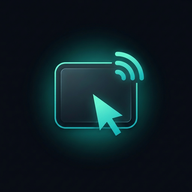
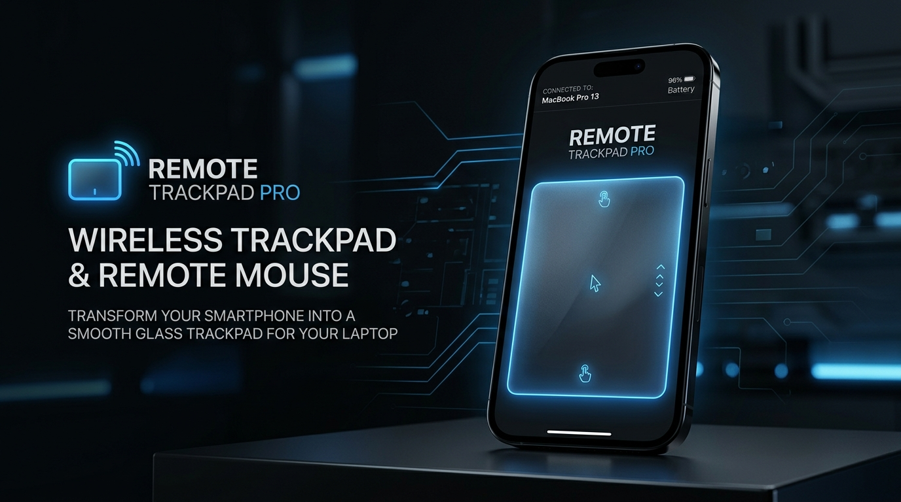
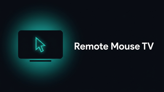

<div align="center">
  
  <h1>Remote Mouse &amp; Gamepad Pro — Website</h1>
  <p>
    <strong>Official landing page and interactive web simulator for Remote Trackpad &amp; Gamepad Pro (v1.5.0).</strong>
  </p>
  <p>
    <a href="https://remotemousewebsite.vercel.app">
      
    </a>
    <a href="https://github.com/AgrShubham/Remote-trackpad-app/releases/tag/v1.5.0">
      
    </a>
    
    
    
  </p>
  <p>
    <a href="https://remotemousewebsite.vercel.app">Live Site</a> •
    <a href="#features">Features</a> •
    <a href="#project-structure">Project Structure</a> •
    <a href="#getting-started">Getting Started</a> •
    <a href="#scripts">Scripts</a> •
    <a href="#companion-repository">Companion App</a>
  </p>
</div>

---

## Overview

This repository contains the marketing, architecture showcase, and release download portal for **[Remote Trackpad & Gamepad Pro](https://github.com/AgrShubham/Remote-trackpad-app)**—a zero-cloud local Wi-Fi controller that turns an Android phone into a wireless trackpad, keyboard, dual-stick gamepad, and media deck for **Windows**, **macOS**, and **Android TV**.

<div align="center">
  
</div>

<br />

<div align="center">
  
</div>

## Features

- **Interactive Live Simulator (`LiveSimulator.tsx`)**
  - Switch between **Touchpad**, **Keyboard**, and **Gamepad** (`Xbox Pro`, `DualSense`, `FPS Aim`, `Racing`) decks inside a virtual phone shell.
  - Streams pointer deltas to a simulated host receiver canvas with live `X`/`Y` cursor coordinates and an interactive keystroke buffer.
- **Reactive Dot-Matrix Background (`DotMatrixCanvas.tsx`)**
  - Fixed, DPR-aware HTML5 `<canvas>` grid that responds to pointer proximity with the active accent color and respects `prefers-reduced-motion`.
- **Dual-Transport Architecture Showcase**
  - Visualizes the split-port networking model: **UDP `5001`** (Auto-Discovery Beacon), **TCP `5000`** (Reliable Control Channel), and **UDP `5002`** (120Hz Turbo Motion Stream) contrasted against TCP-only remotes.
- **5 Interactive Control Deck Chapters**
  - Sticky stage inspector covering *Multi-Touch Trackpad*, *Desktop & TV Keyboard*, *Dual-Stick Gamepad*, *Media & Slide Deck*, and *Auto-Discovery Hub*.
- **Automatic OS Detection & Ecosystem Switcher**
  - Detects visitor OS (`Windows`, `Android TV`, or `macOS`) on load and highlights the matching host server (`RemoteMouseServer.exe`, `android-tv-server.apk`, or `build_macos.sh`).
- **v1.5.0 Release Center & Terminal Quick-Setup**
  - Direct download cards for all v1.5.0 artifacts plus one-click copy commands for Android TV (`adb`) and macOS builds.
- **Adaptive Theming & Modern CSS**
  - Uses CSS `light-dark()` with system preference detection, `localStorage` theme persistence (`Obsidian Dark` / `Studio Light`), 6 live accent presets (`Teal`, `Cobalt`, `Emerald`, `Violet`, `Amber`, `Crimson`), scroll-reveal `IntersectionObserver` animations, and native `<details>`/`<summary>` FAQ accordions.

## Tech Stack

| Layer | Technology |
| --- | --- |
| UI Framework | [React 18](https://react.dev/) (`react`, `react-dom`) |
| Language | [TypeScript 5.6](https://www.typescriptlang.org/) (`strict: true`) |
| Bundler | [Vite 5.4](https://vite.dev/) (`@vitejs/plugin-react`, `esnext` target) |
| Styling | Vanilla CSS with custom properties, `light-dark()`, and `color-mix()` |
| Typography | `Inter` & `JetBrains Mono` via Google Fonts |

## Project Structure

```text
remote_mouse_website/
├── assets/
│   └── banner.jpg                # Hero brand banner
├── public/
│   ├── app-icon.png              # Brand & favicon asset
│   └── tv-banner.png             # Android TV Leanback showcase banner
├── src/
│   ├── components/
│   │   ├── DotMatrixCanvas.tsx   # Pointer-reactive canvas dot grid
│   │   └── LiveSimulator.tsx     # Interactive phone-to-host deck simulator
│   ├── App.tsx                   # Main page sections, theming, and state
│   ├── index.css                 # Design tokens, layout, and responsive styles
│   └── main.tsx                  # React root entry point
├── index.html                    # Document shell, meta tags, and font links
├── package.json                  # Project metadata and npm scripts
├── tsconfig.json                 # TypeScript compiler configuration
└── vite.config.ts                # Vite build configuration
```

## Getting Started

### Prerequisites

- **Node.js** 18+ (LTS recommended)
- **npm** 9+

### Installation & Local Development

```bash
git clone https://github.com/AgrShubham/remote-mouse-website.git
cd remote-mouse-website
npm install
npm run dev
```

Vite will start the local dev server (typically at `http://localhost:5173`) with Hot Module Replacement enabled.

## Scripts

| Command | Description |
| --- | --- |
| `npm run dev` | Start the Vite development server |
| `npm run build` | Run TypeScript type-checking (`tsc`) and build production assets into `dist/` |
| `npm run preview` | Locally preview the production build from `dist/` |

## Deployment

`npm run build` outputs a static bundle to `dist/`, ready to deploy on any static hosting provider (GitHub Pages, Vercel, Netlify, Cloudflare Pages, or Nginx).

```bash
npm run build
```

## Companion Repository

Looking for the Android controller app, Windows/macOS host daemons, or Android TV server source code and release binaries?

- **Source & Releases:** [AgrShubham/Remote-trackpad-app](https://github.com/AgrShubham/Remote-trackpad-app)
- **v1.5.0 Release:** [Releases / v1.5.0](https://github.com/AgrShubham/Remote-trackpad-app/releases/tag/v1.5.0)

